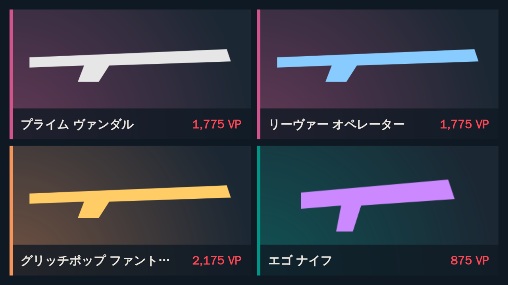

# VALORANT デイリーストア Discord ウィジェット

毎日の VALORANT ストアに並ぶスキン 4 つを、Discord プロフィールのウィジェットに表示します。
([Discord Profiles Can Do This Now](https://www.youtube.com/watch?v=gYv7D83u7yQ) で紹介されているプロフィールウィジェットを利用)

```
GitHub Actions (毎日 09:05 JST)
  ├─ Riot の Cookie で再ログイン → ストア取得 (非公式 API)
  ├─ valorant-api.com からスキン名・画像・レアリティを取得 (日本語)
  ├─ 4 スキンを並べたバナー画像を生成 → widget-assets ブランチに公開
  └─ Discord の Application Identity Profile API でウィジェットのデータを更新
```



## ⚠️ 先に読んでください

- **Discord 側の制約**: 2026 年 7 月末に Discord は個人向けカスタムウィジェットの実験を終了しました。
  **新しいカスタムウィジェットは作成できず**、既存のものも公式サポート外です
  ([Discord Previews](https://x.com/DiscordPreviews/status/2081887185418977488))。
  このツールは「終了前に作成済みで、今も表示されているウィジェット」がある場合に動作します。
  Discord が予告している後継の「Personal Widget」が公開されたら、そちらへの対応が必要になる可能性があります。
- **Riot 側の注意**: ストア取得は Riot 公式には公開されていない API を使います (多くのストア確認ツールと同じ方式)。
  Riot の方針変更で動かなくなる可能性があり、利用は自己責任です。
- **Cookie はパスワード同等**: `RIOT_COOKIES` を持っている人はあなたのアカウントとしてログインできます。
  必ず GitHub Secrets に入れ、他人に見せないでください。

## ウィジェットの表示内容

| 場所 | 内容 |
| --- | --- |
| 上部 (hero) | 4 スキンを並べたバナー画像 + 「10/14 のデイリーストア」 |
| 下部 (stats) | 各スキンの価格と名前 ×4、合計 VP、次の更新時刻 |
| ミニプロフィール | バナー画像 + タイトル |
| アクティビティ横 | スキン名の一覧 |

送信するデータフィールド (`widget/widget-config.json` と同じ名前):

| フィールド | 型 | 例 |
| --- | --- | --- |
| `store_banner` | 画像 | バナー画像の URL (公開しない設定なら 1 枚目のスキン画像) |
| `store_title` | 文字列 | `10/14 のデイリーストア` |
| `store_summary` | 文字列 | `プライム ヴァンダル / エゴ ナイフ / ...` |
| `refresh_at` | 文字列 | `10/15 09:00` |
| `total_price` | 数値 | `6600` |
| `riot_id` | 文字列 | `Player#JP1` |
| `skin1_name` 〜 `skin4_name` | 文字列 | `プライム ヴァンダル` |
| `skin1_price` 〜 `skin4_price` | 数値 | `1775` |
| `skin1_price_text` 〜 `skin4_price_text` | 文字列 | `1,775 VP` |
| `skin1_image` 〜 `skin4_image` | 画像 | スキン画像の URL |

レイアウトを自分で組む場合は、上の名前を Developer Portal の **Games → Widget** でデータフィールドとして追加してください。

## セットアップ

### 1. ウィジェットのレイアウトを設定

既存のウィジェット付きアプリケーションに、`widget/widget-config.json` を読み込みます。
[Discord-Widgets-Extension](https://github.com/TheCreativeGod/Discord-Widgets-Extension) の
**Import** で対象アプリを選んで貼り付けるか、Developer Portal で上の表のとおり手動で設定してください。

### 2. Discord の値を控える

| 値 | 取得場所 |
| --- | --- |
| `DISCORD_APPLICATION_ID` | Developer Portal → General Information → Application ID |
| `DISCORD_BOT_TOKEN` | Developer Portal → Bot → Reset Token |
| `DISCORD_USER_ID` | Discord で自分のアイコンを右クリック → ユーザーIDをコピー (開発者モードを有効化) |

### 3. Riot の Cookie を取得

1. ブラウザでこの URL を開き、Riot アカウントでログイン (「ログインしたままにする」にチェック):
   `https://auth.riotgames.com/authorize?redirect_uri=https%3A%2F%2Fplayvalorant.com%2Fopt_in&client_id=play-valorant-web-prod&response_type=token%20id_token&scope=account%20openid&nonce=1`
2. playvalorant.com に移動したら、もう一度上の URL を開いて `auth.riotgames.com` のページで開発者ツールを開く
   (F12 → **Application** (Chrome) / **ストレージ** (Firefox) → Cookies → `https://auth.riotgames.com`)。
3. `ssid` の値をコピー。`clid` `tdid` `sub` `csid` もあれば `ssid=...; clid=...; tdid=...` の形でまとめると長持ちします。

> `ssid` は HttpOnly なので `document.cookie` には出てきません。必ず開発者ツールのストレージ画面から取ってください。

### 4. GitHub Secrets を登録

リポジトリの **Settings → Secrets and variables → Actions** で登録します。

| Secret | 内容 |
| --- | --- |
| `RIOT_COOKIES` | 手順 3 の Cookie |
| `COOKIE_JAR_KEY` | 適当な長いランダム文字列 (推奨)。更新された Cookie を暗号化して次回に引き継ぐのに使い、Cookie の期限切れを減らします |
| `DISCORD_APPLICATION_ID` / `DISCORD_USER_ID` / `DISCORD_BOT_TOKEN` | 手順 2 の値 |

任意の **Variables**:

| Variable | 内容 |
| --- | --- |
| `BANNER_PUBLISH` | 非公開リポジトリなら `false` (raw ファイルを Discord が読めないため)。1 枚目のスキン画像がメイン画像になります |
| `VALORANT_REGION` | 地域の自動判定がうまくいかない場合に `ap` などを指定 |

### 5. 実行

**Actions → Update VALORANT store widget → Run workflow** で手動実行できます。
以後は毎日 00:05 UTC (09:05 JST、ストア更新の 5 分後) に自動で更新されます。

## ローカルで動かす

GitHub Actions の IP が Riot 側でブロックされる場合は、自宅 PC で動かしてください
(Windows のタスクスケジューラや cron で毎日 `npm start`)。

```bash
npm install
cp .env.example .env   # 値を記入
npm run dry-run        # Discord には送らず、out/ にバナーと store.json を出力
npm start              # Discord のウィジェットを更新
npm test
```

## トラブルシューティング

| 症状 | 対処 |
| --- | --- |
| `Riot session cookies are invalid or expired` | Cookie の期限切れ。手順 3 をやり直して `RIOT_COOKIES` を更新 |
| `Riot auth returned 403` | IP が Cloudflare にブロックされている可能性。ローカル実行を試す |
| `APPLICATION_IDENTITY_PROVIDER_USER_ID_MISMATCH` | 既存の identity と ID が違う。`DISCORD_IDENTITY_ID` に以前使った ID (例: `0`) を設定 |
| ウィジェットが「同期中」のまま | ウィジェットのデータフィールド名と送信しているフィールド名が一致しているか確認 |
| バナーの文字が豆腐 (□) になる | 日本語フォントが無い。`BANNER_FONT_PATH` にフォントファイルのパスを指定 |

## 参考

- [How to Make Discord Widgets (Chloe Cinders)](https://chloecinders.com/blog/discord-widgets)
- [discord-github-profile-widget (AdityaLF)](https://github.com/AdityaLF/discord-github-profile-widget)
- [Valorant API Docs (techchrism)](https://valapidocs.techchrism.me/)
- [valorant-api.com](https://valorant-api.com/)
